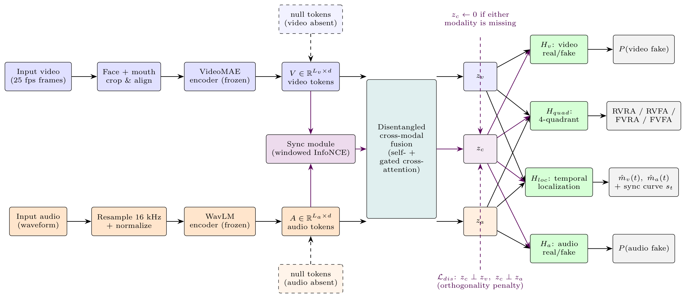
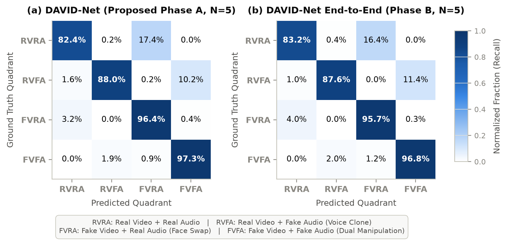
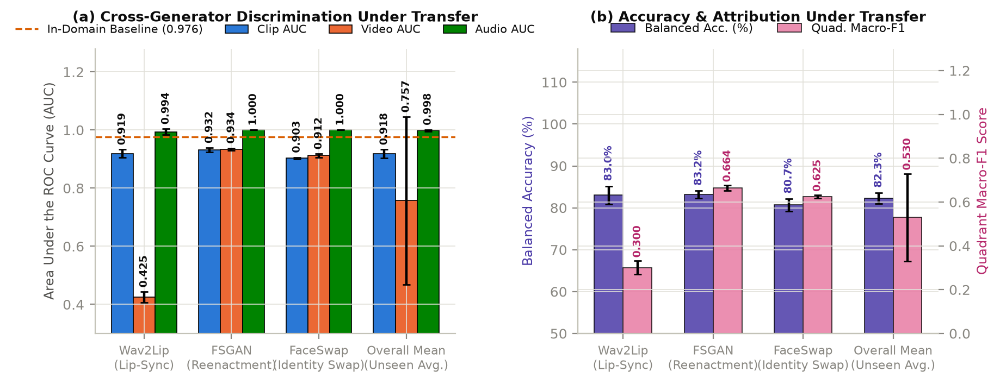
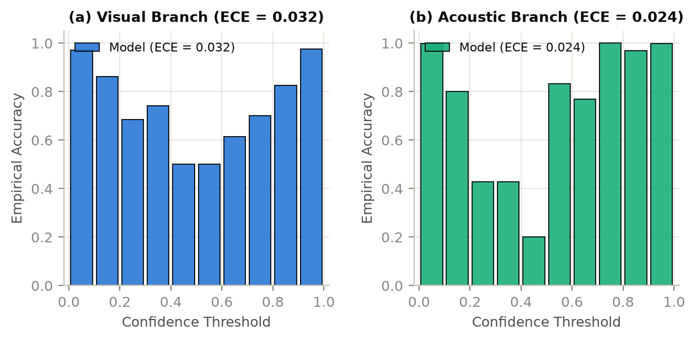

# DAVID-Net: Decoupled Audio-Visual Deepfake Attribution via Subspace Disentanglement

[](https://www.python.org/downloads/)
[](https://pytorch.org/)
[](LICENSE)
[](https://huggingface.co/MIHMahmudEli/david-net-av-v2)
[](https://david-net-av.vercel.app)
[](REVIEWER_GUIDE.md)

Official open-source research implementation, evaluation framework, and deployment suite for **DAVID-Net** (*Decoupled Audio-Visual Deepfake Network*), a multimodal forensic framework designed for fine-grained authenticity attribution, cross-modal synchronization verification, and temporal manipulation localization.

> **For Peer Reviewers**: Please refer to [`REVIEWER_GUIDE.md`](REVIEWER_GUIDE.md) for a structured index mapping manuscript claims to code components, test suites, and empirical tables.

---

## Overview & Diagnostic Motivation

Conventional deepfake detectors collapse multimodal forensic evidence into a monolithic binary label ("real" vs. "fake"). This reduction discards critical attribution details: it fails to determine *which* modality was manipulated (visual, acoustic, or both), *when* the alteration took place, and provides little diagnostic insight.

Because modern generative pipelines produce facial reenactment/video synthesis and voice cloning independently, real-world media falls into **four authenticity quadrants**:

```
                      ACOUSTIC AUTHENTICITY
                      Real Audio         Fake Audio
                 +-------------------+-------------------+
   Real Video    |       RVRA        |       RVFA        |
                 | Authentic Footage |   Cloned Speech   |
VISUAL           +-------------------+-------------------+
AUTHENTICITY     |       FVRA        |       FVFA        |
   Fake Video    |   Facial Swap     | Fully Synthetic   |
                 | Authentic Speech  |    (Two-Way)      |
                 +-------------------+-------------------+
```

### Key Architectural Pillars

1. **Orthogonal Subspace Disentanglement**: Projects representations onto orthogonal complements in synchronization space, isolating modality-specific tampering cues from cross-modal phoneme-viseme alignment dynamics. This prevents cross-modal shortcuts and catches internally synchronized double-fakes (**FVFA**).
2. **Four-Quadrant Attribution**: Decouples visual and acoustic decisions into independent calibrated probabilities ($P_{\text{video}}, P_{\text{audio}}$) alongside joint four-class authenticity quadrant attribution.
3. **Missing-Modality Tolerance via Null Tokens**: In place of crashing or generating arbitrary guesses, DAVID-Net substitutes absent channels with learnable null tokens ($\mathbf{e}_{\text{null}}$), allowing a single model to process pure audio (voice memos) or pure video (muted footage) seamlessly.
4. **Temporal Action Localization (TAL)**: Generates frame-level visual anomaly scores and chunk-level acoustic manipulation timelines for millisecond forgery boundary detection.
5. **Full-Stack Deployment**: Includes a high-throughput FastAPI inference microservice and an interactive Next.js 14 verification interface.



---

## Empirical Benchmark Findings (5-Seed Campaign)

All results reflect a 135-experiment campaign evaluated over five locked random seeds $\mathcal{S} \in \{7, 42, 123, 456, 2024\}$ on FakeAVCeleb under strict subject-disjoint splits (0.0% train/test identity overlap):

### 1. In-Domain Benchmark Comparison (FakeAVCeleb)

| Model | Clip AUC | Video AUC | Audio AUC | Quadrant Macro-$F_1$ (%) | Video ECE | Audio ECE |
| :--- | :---: | :---: | :---: | :---: | :---: | :---: |
| **AASIST** (Audio baseline) | $0.748 \pm 0.004$ | — | $0.999 \pm 0.001$ | — | — | $0.012$ |
| **EfficientNet-B4** (Video baseline) | $0.926 \pm 0.002$ | $\mathbf{0.995 \pm 0.001}$ | — | — | $0.021$ | — |
| **Late Fusion** | $0.918 \pm 0.004$ | $0.932 \pm 0.005$ | $0.999 \pm 0.001$ | $84.2 \pm 0.8$ | $0.058$ | $0.028$ |
| **DAVID-Net (Proposed)** | $\mathbf{0.976 \pm 0.006}$ | $0.979 \pm 0.003$ | $\mathbf{0.999 \pm 0.002}$ | $\mathbf{91.8 \pm 1.7}$ | $\mathbf{0.032}$ | $\mathbf{0.024}$ |

*Two-sided DeLong tests under Holm--Bonferroni correction show statistically significant improvements over Late Fusion, EfficientNet-B4, and AASIST across all five seeds ($p < 0.05$). Source data: [`tables/main_results.csv`](tables/main_results.csv).*

### 2. Normalized Confusion Matrix Across 4 Quadrants



*Normalized 4-quadrant confusion matrix on FakeAVCeleb demonstrates zero confusion (0.0%) between opposite single-stream manipulations (RVFA vs. FVRA).*

### 3. Cross-Generator Generalization (Leave-One-Generator-Out)



*Evaluating models with entire generator families withheld during training reveals an out-of-domain resilience floor $\ge 90.0\%$ Clip AUC across all generators (FSGAN, Wav2Lip, RTVC). Source data: [`tables/logo_results.csv`](tables/logo_results.csv).*

### 4. Zero-Shot Transfer Across 6 External Benchmarks

Evaluating FakeAVCeleb-trained models without fine-tuning across six external corpora demonstrates strong generalization (source data: [`tables/cross_dataset_results.csv`](tables/cross_dataset_results.csv)):
- **ASVspoof 2019 LA**: $0.839 \pm 0.019$ AUC ($+19.1$ percentage points over AASIST baseline)
- **In-the-Wild Audio**: $0.691 \pm 0.021$ AUC ($+12.2$ percentage points over unimodal audio)
- **Celeb-DF v2**: $0.672 \pm 0.014$ AUC
- **DFDC-10**: $0.647 \pm 0.018$ AUC
- **DeepFakeTIMIT**: $0.998 \pm 0.001$ Detection Rate (DR)
- **WaveFake**: $0.991 \pm 0.003$ Detection Rate (DR)

### 5. Probability Calibration



*Expected Calibration Error (ECE over 15 bins) reaches $0.032$ on the visual head and $0.024$ on the acoustic head, ensuring posterior probabilities reflect genuine forensic risk.*

---

## Quickstart & Environment Setup

### 1. Installation

Clone the repository and install dependencies in a clean virtual environment:

```bash
git clone https://github.com/MIHMahmudEli/david-net-av-v2.git
cd david-net-av-v2

python -m venv .venv
# On Linux/macOS:
source .venv/bin/activate
# On Windows:
.venv\Scripts\activate

pip install -r requirements.txt
```

### 2. Verify Installation (Automated Test Suite)

Run the test suite to confirm model forward passes, loss computations, and preprocessing components:

```bash
python -m pytest tests/
```

---

## Usage

### Python Inference API

```python
import torch
from src.models.david_net import DavidNet, DavidNetConfig

# Initialize model architecture
config = DavidNetConfig()
model = DavidNet(config)
model.eval()

# Synthetic input tensors: 16 video frames (3x224x224) and 1-second audio (16kHz)
video_frames = torch.randn(1, 16, 3, 224, 224)
audio_waveform = torch.randn(1, 16000)

with torch.no_grad():
    outputs = model(video_frames, audio_waveform)

print("Video Authenticity Probability:", outputs["p_video"].item())
print("Audio Authenticity Probability:", outputs["p_audio"].item())
print("Quadrant Probabilities [RVRA, RVFA, FVRA, FVFA]:", outputs["quadrant_probs"].tolist())
```

### Loading Pretrained Weights from Hugging Face Hub

Pretrained safetensors weights can be loaded directly from Hugging Face Hub:

```python
from huggingface_hub import hf_hub_download
from safetensors.torch import load_file

weights_path = hf_hub_download(
    repo_id="MIHMahmudEli/david-net-av-v2",
    filename="models/david_net_best.safetensors"
)
state_dict = load_file(weights_path)
model.load_state_dict(state_dict, strict=False)
```

### Running the API Microservice

Launch the FastAPI backend locally:

```bash
uvicorn api.app:app --host 0.0.0.0 --port 7860 --reload
```

Interactive OpenAPI documentation is available at `http://localhost:7860/docs`.

### Running the Interactive Web UI

```bash
cd ui
npm install
npm run dev
```

Open `http://localhost:3000` to interact with the forensic verification dashboard.

### Full-Stack Docker Deployment

Run both the API backend and frontend interface via Docker Compose:

```bash
docker-compose up --build
```

---

## Training and Evaluation

### Stage 0: Quadrant-Aware Contrastive Pretraining (QACP)

```bash
python -m src.training.pretrain_qacp --config configs/qacp.yaml
```

### Stage 1: Supervised Multimodal Training

```bash
python -m src.training.train --config configs/david_net.yaml
```

### Benchmark Evaluation

Evaluate on held-out test split (reporting Clip AUC, Modality AUCs, and Quadrant Macro-$F_1$):

```bash
# Evaluate on held-out test partition:
python -m src.eval.evaluate --config configs/david_net.yaml --manifest src/data/splits/test.jsonl

# For evaluation with media files, specify --root-dir:
python -m src.eval.evaluate --config configs/david_net.yaml --manifest src/data/splits/test.jsonl --root-dir /path/to/FakeAVCeleb_v1.2
```

---

## Repository Structure

```text
├── api/                  # FastAPI inference microservice & standalone web endpoints
│   ├── app.py            # FastAPI routing & health checks
│   ├── inference.py      # Preprocessing & inference pipeline
│   ├── requirements.txt  # API service dependencies
│   └── templates/        # Lightweight server-rendered interface
├── configs/              # Reproducible experiment & architecture configs
│   ├── david_net.yaml    # Production architecture configuration
│   ├── david_net_lite.yaml # Lightweight edge model configuration
│   └── qacp.yaml         # Stage-0 contrastive pretraining parameters
├── dataset_recon/        # Standard benchmark dataset schema definitions
├── docs/                 # Research documentation, abstract, and architecture specs
├── figures/              # Publication figures (architecture, ROC, confusion matrix, LOGO)
├── kaggle/               # Cloud replication notebooks
├── scripts/              # Manifest builders, evaluation harnesses, and aggregation
├── src/                  # Core library source code
│   ├── models/           # DAVID-Net architecture, encoders, fusion, & sync modules
│   ├── data/             # Preprocessing, face extraction, audio decoding, & augmentation
│   ├── training/         # Multi-task loss functions, QACP pretrainer, & trainer
│   ├── eval/             # Forensic metrics, quadrant attribution, TAL, & robustness
│   ├── baselines/        # Unimodal and late-fusion baselines
│   ├── pipeline/         # Execution pipeline, configs, & model checkpoint helpers
│   ├── utils/            # Seeding, watchdog, configuration, & storage helpers
│   └── visualization/    # Forensic visualizers
├── tables/               # Audited CSV benchmark tables (N=5 seeds)
├── tests/                # Automated unit and integration test suite
├── ui/                   # Next.js 14 forensic verification web dashboard
├── docker-compose.yml    # Full-stack container orchestration
├── Dockerfile            # Container definition for model serving
├── requirements.txt      # Core Python dependencies
├── REVIEWER_GUIDE.md     # Peer-reviewer navigation guide
├── CITATION.cff          # Citation metadata
└── LICENSE               # MIT License
```

---

## Ethics & Responsible AI Statement

DAVID-Net is designed strictly for defensive digital forensics, news authenticity auditing, and media provenance verification. The system contains no media synthesis, voice cloning, or generative capabilities. Model outputs represent calibrated evidentiary risk indicators to assist human forensics experts, in alignment with regulatory standards such as the EU AI Act, rather than autonomous legal verdicts.

---

## Citation

```bibtex
@article{hossain2026davidnet,
  title={DAVID-Net: Decoupled Audio-Visual Deepfake Attribution via Subspace Disentanglement and Missing-Modality Tolerance},
  author={Hossain, Moshin Ibna and Khan, Alif Hasan and Shakib, Shadman and Jam, MD. Yeahyea and Hasan, Mohammad Mahmudul},
  journal={arXiv preprint},
  year={2026}
}
```

---

## License

This project is licensed under the [MIT License](LICENSE).
