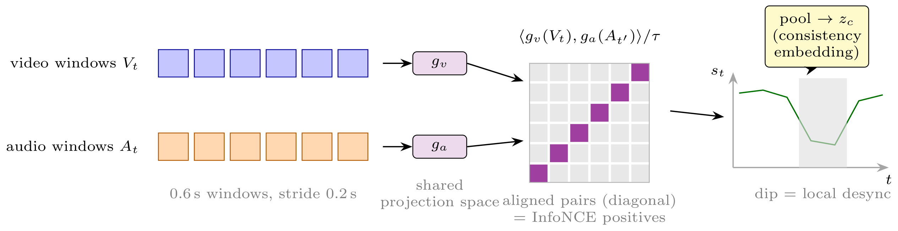

# Architecture Overview: DAVID-Net

DAVID-Net (*Decoupled Audio-Visual Forensic Network*) is designed to resolve two fundamental limitations of conventional multimodal deepfake detectors:
1. **Premature Cross-Modal Entanglement**: Fusing audio and video features early causes detectors to learn cross-modal synchronization shortcuts (simply equating lip-audio misalignment to manipulation), which catastrophically fails on internally consistent "double-fakes" ($\text{FVFA}$) where synthetic video is lip-synced to cloned speech.
2. **Missing-Modality Inflexibility**: Real-world media forensics often deals with incomplete streams (such as muted surveillance recordings or audio-only phone calls), causing multi-stream systems that lack null-handling to crash or degrade severely.

---

## High-Level System Architecture

### 1. Dual Feature Extraction Frontends
- **Visual Branch**: Video frames are processed through facial tracking, landmark alignment, and bounding box cropping for both full face and perioral (mouth) regions. Spatiotemporal visual features capture facial artifact boundaries and phoneme-to-viseme transitions.
- **Acoustic Branch**: Audio streams (16 kHz) are converted to spectral representations to detect vocoder artifacts, synthetic acoustic transients, and spectral discontinuity footprints.

### 2. Orthogonal Subspace Disentanglement
Rather than concatenating features into a monolithic representation, DAVID-Net decomposes multimodal representations into orthogonal subspaces:
- **Visual Authenticity Subspace ($\mathcal{S}_V$)**: Encodes spatial blending artifacts, chromatic boundaries, and generative noise fingerprints.
- **Acoustic Authenticity Subspace ($\mathcal{S}_A$)**: Encodes voice cloning vocoder signatures, phase inconsistencies, and synthetic spectral anomalies.
- **Cross-Modal Synchronization Subspace ($\mathcal{S}_{\text{sync}}$)**: Encodes temporal phoneme-viseme alignment dynamics.

By enforcing mathematical orthogonality between the modality authenticity subspaces and the synchronization subspace, the model ensures that synchronization cues do not contaminate modality-specific veracity judgments.

---

## Phoneme-Viseme Cross-Modal Synchronization

The synchronization module aligns perioral motion embeddings with acoustic phoneme representations across temporal sliding windows:
- Cross-attention evaluates temporal correspondence between lip movement dynamics and speech acoustic envelopes.
- Misaligned speech-lip pairings are detected independently of spectral manipulation artifacts, enabling the model to distinguish pure desynchronization from authentic or synthetic speech.

---

## Missing-Modality Tolerance: Learnable Null Tokens

When media streams arrive with a missing modality:
- **Muted or Silent Video**: The acoustic stream is substituted with a learnable null token $\mathbf{e}_{\text{null}}^{(A)}$. The model routes inference exclusively through the visual authenticity head without generating spurious acoustic predictions.
- **Audio-Only Phone Calls / Memos**: The visual channel is substituted with a learnable null token $\mathbf{e}_{\text{null}}^{(V)}$. The acoustic head operates as a standalone voice anti-spoofing detector.

This mechanism enables a single unified architecture to serve video forensics, voice anti-spoofing, and joint multimodal attribution without requiring multiple specialized models.
